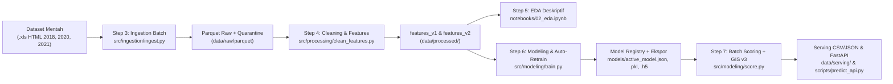

# SiPeka — Sistem Prediksi Volume Pengangkutan Sampah DKI Jakarta

Proyek Big Data (**Kelompok 20 — tulang keBAKAR · Teknologi Big Data**) untuk memprediksi volume pengangkutan sampah harian (`m³`) di kali, sungai, situ, waduk, dan PHB DKI Jakarta menggunakan **PySpark**, **Spark MLlib**, **FastAPI**, dan **Plotly**, dilengkapi sistem **Continuous Auto-Retraining (Champion vs Challenger)** serta ekspor model ke **`.pkl`** dan **`.h5`** untuk integrasi dashboard **Laravel**.

---

## Latar Belakang & Tujuan

Volume pengangkutan sampah harian di badan air DKI Jakarta berfluktuasi secara signifikan antar waktu dan wilayah, sehingga penjadwalan truk dan alokasi petugas Dinas Lingkungan Hidup kurang efisien. **SiPeka** membangun pipeline batch & auto-retraining end-to-end untuk:

1. Mengolah dan memvalidasi data pengangkutan harian berskala jutaan baris (`2018`, `2020`, `2021`) secara terstruktur (**Step 3 & Step 4**).
2. Menganalisis tren waktu, pola musiman/harian, dan titik lokasi dengan beban tertinggi (**Step 5 — EDA**).
3. Melatih dan membandingkan model regresi (`Baseline`, `LinearRegression`, `RandomForestRegressor`, `GBTRegressor`) dengan pembagian waktu tanpa *data leakage* (**Step 6 — Modeling**).
4. Menjalankan **Auto-Retraining berkelanjutan (Champion vs Challenger)** setiap ada data baru, mengekspor model pemenang ke `.pkl` dan `.h5`, serta menghasilkan forecast 30 hari + pemetaan GIS `dataset_titik_phb-v3.json` siap pakai untuk dashboard **Laravel** (**Step 7–8**).

---

## Arsitektur Pipeline



---

## Ringkasan Dataset & Kualitas Data

Sumber dataset volume sampah berasal dari Jakarta Open Data (`data.jakarta.go.id`) untuk tahun `2018`, `2020`, dan `2021` (tahun `2019` tidak tersedia pada sumber data), dipadukan dengan master koordinat GIS **`Dataset/dataset_titik_phb-v3.json`** (`974` titik PHB/LPS SILIKA DLH DKI Jakarta).

| Tahap | Jumlah Baris | Keterangan |
|-------|-------------:|------------|
| Data masuk (2018 + 2020 + 2021) | `1.786.773` | `515.225` (2018) + `624.379` (2020) + `647.169` (2021) |
| Valid setelah ingestion (Step 3) | `1.784.956` | `1.817` baris masuk karantina (tanggal/volume tidak valid) |
| Setelah filter target tidak null | `1.293.664` | `491.292` baris volume kosong/placeholder dibuang |
| Setelah deduplikasi harian (Step 4) | **`1.068.562`** | Agregasi `sum(volume)` per `(titik_lokasi, tanggal)` (`2.991` titik unik) |
| Outlier ekstrem (`> P99,9 = 65,52 m³`) | `1.068` (`0,10%`) | Ditandai di `is_outlier` (termasuk `72` anomali Juli 2018 hingga `156.249.999 m³`) |
| Master Titik GIS (`dataset_titik_phb-v3.json`) | `974` (`963` unik) | `882` titik cocok langsung dengan histori pengangkutan SiPeka |

---

## Temuan Utama EDA (Step 5)

Dari `1.068.562` baris bersih (`is_outlier = 0` untuk pola operasional normal, `35,37%` observasi bernilai `0 m³`, median `0,50 m³`):

- **Tren tahunan normal:** `2018` = `366.811,48 m³` (`1,46 m³/baris`), `2020` = `760.925,36 m³` (`2,63 m³/baris`), `2021` = `789.941,13 m³` (`1,50 m³/baris`). Puncak bulanan terjadi pada **Januari 2021** (`150.173,47 m³`).
- **Wilayah tertinggi:** **Jakarta Barat** secara total (`670.378,59 m³`, `1.074` titik), sedangkan **Jakarta Pusat** tertinggi secara rata-rata per observasi (`2,85 m³`).
- **Pola musiman & mingguan:** musim hujan (Okt–Apr) rata-rata `1,92 m³` (**17,4% lebih tinggi** dibanding musim kemarau `1,63 m³`). Puncak mingguan pada **Selasa–Rabu** (`1,91 m³`), terendah **Jumat–Minggu** (`1,71–1,72 m³`).
- **Titik lokasi tertinggi (total normal):** `KALI / SUNGAI CILIWUNG EMPLASEMENT PA MANGGARAI` (`15.748,50 m³`), disusul `SEKATAN HDPE KALI SODETAN SEKRETARIS` (`10.760,50 m³`) dan `BANJIR KANAL BARAT SEASONS CITY` (`9.849,00 m³`).

---

## Hasil Modeling & Auto-Retraining (Step 6)

### Pembagian Data (Split Kronologis 70 / 15 / 15)

Pemisahan dilakukan berbasis batas tanggal ketat (`train < validation < test`, tanpa *random split*) agar tidak terjadi *data leakage*:

| Partisi | Rentang Tanggal | Jumlah Baris | Proporsi | Jumlah Titik |
|---------|-----------------|-------------:|---------:|-------------:|
| **Train** | `2018-01-01` s.d. `2021-07-03` | `748.979` | `70,09%` | `2.987` |
| **Validation** | `2021-07-04` s.d. `2021-10-02` | `160.615` | `15,03%` | `1.768` |
| **Test** | `2021-10-03` s.d. `2021-12-31` | `158.968` | `14,88%` | `1.767` |

### Perbandingan Model (`v1` Kalender+Lokasi vs `v2` +10 Fitur Historis)

| Model | Fitur | RMSE Valid | MAE Valid | R² Valid | RMSE Test | MAE Test | R² Test |
|-------|-------|-----------:|----------:|---------:|----------:|---------:|--------:|
| Baseline (mean per titik) | `-` | `3,9426` | `1,8971` | `-0,3089` | `4,1141` | `1,5136` | `-0,0220` |
| LinearRegression | `v1` | `4,0781` | `2,1675` | `-0,4004` | `4,2482` | `1,8090` | `-0,0897` |
| RandomForest | `v1` | `3,9283` | `1,9235` | `-0,2994` | `4,0993` | `1,4795` | `-0,0147` |
| GBTRegressor | `v1` | `4,1169` | `1,9077` | `-0,4271` | `4,9258` | `1,8406` | `-0,4651` |
| LinearRegression (`regParam=0,01`) | `v2` | `3,2970` | `0,9474` | `+0,0848` | `3,7404` | `0,9284` | `+0,1555` |
| **LinearRegression (`regParam=0,05`)** *(Champion Aktif)* | **`v2`** | **`3,2933`** | **`0,9446`** | **`+0,0869`** | **`3,7333`** | `0,8952` | **`+0,1587`** |
| RandomForest (`50`, depth `6`) | `v2` | `3,6390` | `1,4169` | `-0,1149` | `3,7520` | **`0,7462`** | `+0,1503` |
| GBTRegressor (`30`, depth `4`) | `v2` | `3,5662` | `1,0763` | `-0,0707` | `3,7416` | `0,7546` | `+0,1549` |

- **Champion Aktif (`models/active_model.json`):** `linearregression_v2_20261123_104848` (`RMSE valid = 3,2933 m³`, `RMSE test = 3,7333 m³`, `MAE test = 0,8952 m³`, `R² test = +0,1587`), otomatis dipromosikan oleh `src/modeling/train.py` karena mengalahkan Champion sebelumnya (`RMSE valid = 3,2970 m³`).
- **Ekspor Portabel (`.pkl` & `.h5`):** bobot `PipelineModel` PySpark diekstrak ke `models/active_model.pkl`, `models/active_model.h5`, dan `models/active_model.joblib` dengan selisih numerik `max_abs_diff = 0,0` terhadap PySpark, sehingga dapat dijalankan dari Laravel/FastAPI dalam `< 1 ms` tanpa JVM/Spark.

---

## Struktur Repositori

```text
Sipeka-PJBL/
├── config/
│   └── settings.py                  # Konfigurasi path, HDFS, dan PostgreSQL
├── Dataset/
│   └── dataset_titik_phb-v3.json    # Master 974 titik PHB/LPS SILIKA v3 + koordinat GPS
├── data/serving/
│   ├── active_model_summary.json    # Ringkasan model aktif & metrik
│   ├── titik_phb_v3_forecast.json   # 974 titik PHB v3 + hasil forecast 30 hari (siap untuk Laravel)
│   ├── forecast_per_titik.csv       # Forecast 30 hari untuk 2.991 titik SiPeka + atribut GIS v3
│   ├── forecast_harian_wilayah.csv  # Agregat forecast 30 hari per wilayah
│   └── predictions_harian_wilayah.csv # Aktual vs prediksi harian per wilayah (data test)
├── docker/
│   ├── Dockerfile.jupyter           # Image JupyterLab + PySpark 3.5 + JDBC driver
│   ├── spark-defaults.conf          # Konfigurasi memory & HDFS Spark
│   └── initdb/01_init.sql           # DDL awal PostgreSQL (Step 1)
├── docs/
│   ├── ringkasan_model.md           # Dokumentasi lengkap arsitektur, metrik, & auto-retrain
│   └── figures/                     # 14 pasang grafik interaktif Plotly (.html & .json)
├── models/
│   ├── active_model.json            # Model Registry (pointer Champion aktif)
│   ├── active_model.pkl             # Model aktif format Pickle (tanpa Spark, <1 ms/prediksi)
│   ├── active_model.h5              # Model aktif format HDF5 (.h5)
│   ├── active_model.joblib          # Model aktif format Joblib
│   ├── retrain_history.json         # Riwayat audit Champion vs Challenger
│   ├── linearregression_v2_20261123_104848/          # PipelineModel Spark Champion aktif
│   └── linearregression_v2_20261121_170617/          # PipelineModel Spark baseline awal
├── notebooks/
│   ├── 02_eda.ipynb                 # Step 5: EDA deskriptif (ber-output)
│   └── 03_modeling.ipynb            # Step 6: Modeling & evaluasi (ber-output)
├── scripts/
│   ├── auto_retrain.py              # Orchestrator auto-retrain end-to-end (sekali jalan / --watch)
│   ├── predict_api.py               # CLI & FastAPI server berbasis active_model.pkl untuk Laravel
│   ├── setup_scheduler_windows.ps1  # Pendaftaran jadwal mingguan di Windows Task Scheduler
│   └── test_connections.py          # Uji 4 koneksi: Spark, HDFS, PostgreSQL, JDBC
├── src/
│   ├── ingestion/ingest.py          # Step 3: Ekstraksi HTML .xls -> Parquet raw + quarantine
│   ├── processing/clean_features.py # Step 4: Cleaning, deduplikasi, fitur v1 & v2
│   ├── modeling/train.py            # Step 6: Auto-retrain Champion vs Challenger
│   ├── modeling/score.py            # Step 7: Batch scoring 30 hari + join dataset_titik_phb-v3.json
│   ├── modeling/export_model.py     # Ekspor PipelineModel PySpark ke .pkl & .h5
│   └── utils/spark_session.py       # Factory SparkSession (Docker & lokal Windows)
├── .env.example
├── .gitignore
├── docker-compose.yml
└── requirements.txt
```

---

## Cara Menjalankan

### 1. Pipeline Data & Auto-Retraining (Champion vs Challenger)

Setiap ada file `.xls` baru di `Dataset/`, jalankan orchestrator otomatis:

```bash
# Cek perubahan data -> ingest -> clean_features -> train (Champion vs Challenger) -> score & ekspor .pkl/.h5
python scripts/auto_retrain.py --mode fast

# Paksa latihan ulang walau data belum berubah
python scripts/auto_retrain.py --mode fast --force

# Mode daemon berulang otomatis (mis. cek setiap 24 jam)
python scripts/auto_retrain.py --watch --interval-minutes 1440
```

Untuk mendaftarkan jadwal mingguan otomatis di **Windows Task Scheduler** (Minggu pukul 02:00):
```powershell
powershell -ExecutionPolicy Bypass -File scripts\setup_scheduler_windows.ps1
```

### 2. Prediksi Cepat & Integrasi Dashboard Laravel (`.pkl` / `.h5` Tanpa Spark)

Prediksi langsung via CLI (`active_model.pkl`, tanpa menyalakan JVM/Spark):
```bash
python scripts/predict_api.py --titik "Sungai Utan Kayu Jl Pengayoman" --tanggal 2026-11-24 --horizon 7
```

Atau jalankan REST API FastAPI untuk dipanggil oleh Laravel (`Http::get`):
```bash
python scripts/predict_api.py --serve --port 8000
```
Endpoint yang tersedia:
- `GET http://127.0.0.1:8000/api/model-info` — versi model aktif & metrik evaluasi
- `GET http://127.0.0.1:8000/api/predict?titik=Sungai%20Utan%20Kayu%20Jl%20Pengayoman&tanggal=2026-11-24&horizon=7` — prediksi volume sampah (`m³`) + koordinat & metadata PHB v3
- `GET http://127.0.0.1:8000/api/titik-phb?wilayah=JAKARTA%20PUSAT` — daftar titik `dataset_titik_phb-v3.json` beserta prediksi 30 hari untuk peta Leaflet
