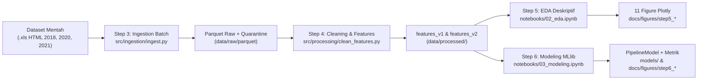

# SiPeka — Sistem Prediksi Volume Pengangkutan Sampah DKI Jakarta

Proyek Big Data (**Kelompok 20 — tulang keBAKAR · Teknologi Big Data**) untuk memprediksi volume pengangkutan sampah harian (`m³`) di kali, sungai, situ, waduk, dan PHB DKI Jakarta menggunakan **PySpark**, **Spark MLlib**, dan **Plotly**.

---

## Latar Belakang & Tujuan

Volume pengangkutan sampah harian di badan air DKI Jakarta berfluktuasi secara signifikan antar waktu dan wilayah, sehingga penjadwalan truk dan alokasi petugas Dinas Lingkungan Hidup kurang efisien. **SiPeka** membangun pipeline batch end-to-end untuk:

1. Mengolah dan memvalidasi data pengangkutan harian berskala jutaan baris (`2018`, `2020`, `2021`) secara terstruktur.
2. Menganalisis tren waktu, pola musiman/harian, dan titik lokasi dengan beban tertinggi (**Step 5 — EDA**).
3. Melatih dan membandingkan model regresi (`Baseline`, `LinearRegression`, `RandomForestRegressor`, `GBTRegressor`) dengan pembagian waktu tanpa *data leakage* (**Step 6 — Modeling**).

---

## Arsitektur Pipeline



**Status implementasi di repositori ini:**
- **Selesai & terverifikasi (Step 1, 3, 4, 5, 6):** konfigurasi Docker & Spark (`docker/`, `config/`, `src/utils/`), ingestion batch (`src/ingestion/`), cleaning & feature engineering (`src/processing/`), notebook EDA & modeling beserta output eksekusi (`notebooks/`), artefak model (`models/`), dan seluruh figure evaluasi (`docs/figures/`).
- **Tahap berikutnya (Step 7–8):** serving layer PostgreSQL (`score.py`) dan integrasi ke dashboard Streamlit.

---

## Ringkasan Dataset & Kualitas Data

Sumber dataset berasal dari Jakarta Open Data (`data.jakarta.go.id`) untuk tahun `2018`, `2020`, dan `2021` (tahun `2019` tidak tersedia pada sumber data). File `.xls` sumber berformat tabel HTML dan diproses streaming oleh `src/ingestion/ingest.py`.

| Tahap | Jumlah Baris | Keterangan |
|-------|-------------:|------------|
| Data masuk (2018 + 2020 + 2021) | `1.786.773` | `515.225` (2018) + `624.379` (2020) + `647.169` (2021) |
| Valid setelah ingestion (Step 3) | `1.784.956` | `1.817` baris masuk karantina (tanggal/volume tidak valid) |
| Setelah filter target tidak null | `1.293.664` | `491.292` baris volume kosong/placeholder dibuang |
| Setelah deduplikasi harian (Step 4) | **`1.068.562`** | Agregasi `sum(volume)` per `(titik_lokasi, tanggal)` |
| Outlier ekstrem (`> P99,9 = 65,52 m³`) | `1.068` (`0,10%`) | Ditandai di `is_outlier` (termasuk `72` anomali Juli 2018 hingga `156.249.999 m³`) |

---

## Temuan Utama EDA (Step 5)

Dari `1.068.562` baris bersih (`is_outlier = 0` untuk pola operasional normal, `35,37%` observasi bernilai `0 m³`, median `0,50 m³`):

- **Tren tahunan normal:** `2018` = `366.811,48 m³` (`1,46 m³/baris`), `2020` = `760.925,36 m³` (`2,63 m³/baris`), `2021` = `789.941,13 m³` (`1,50 m³/baris`). Puncak bulanan terjadi pada **Januari 2021** (`150.173,47 m³`).
- **Wilayah tertinggi:** **Jakarta Barat** secara total (`670.378,59 m³`, `1.074` titik), sedangkan **Jakarta Pusat** tertinggi secara rata-rata per observasi (`2,85 m³`).
- **Pola musiman & mingguan:** musim hujan (Okt–Apr) rata-rata `1,92 m³` (**17,4% lebih tinggi** dibanding musim kemarau `1,63 m³`). Puncak mingguan pada **Selasa–Rabu** (`1,91 m³`), terendah **Jumat–Minggu** (`1,71–1,72 m³`).
- **Titik lokasi tertinggi (total normal):** `KALI / SUNGAI CILIWUNG EMPLASEMENT PA MANGGARAI` (`15.748,50 m³`), disusul `SEKATAN HDPE KALI SODETAN SEKRETARIS` (`10.760,50 m³`) dan `BANJIR KANAL BARAT SEASONS CITY` (`9.849,00 m³`).

---

## Hasil Modeling & Evaluasi (Step 6)

### Pembagian Data (Split Kronologis 70 / 15 / 15)

Pemisahan dilakukan berbasis batas tanggal ketat (`train < validation < test`, tanpa *random split*) agar tidak terjadi *data leakage*:

| Partisi | Rentang Tanggal | Jumlah Baris | Proporsi | Jumlah Titik |
|---------|-----------------|-------------:|---------:|-------------:|
| **Train** | `2018-01-01` s.d. `2021-07-03` | `748.979` | `70,09%` | `2.987` |
| **Validation** | `2021-07-04` s.d. `2021-10-02` | `160.615` | `15,03%` | `1.768` |
| **Test** | `2021-10-03` s.d. `2021-12-31` | `158.968` | `14,88%` | `1.767` |

*(Outlier `is_outlier == 1` dikecualikan hanya saat melatih model; evaluasi `validation` dan `test` dilakukan penuh apa adanya dengan clamping prediksi `>= 0`.)*

### Perbandingan Model (`v1` Kalender+Lokasi vs `v2` +10 Fitur Historis)

| Model | Fitur | RMSE Valid | MAE Valid | R² Valid | RMSE Test | MAE Test | R² Test |
|-------|-------|-----------:|----------:|---------:|----------:|---------:|--------:|
| Baseline (mean per titik) | `-` | `3,9426` | `1,8971` | `-0,3089` | `4,1141` | `1,5136` | `-0,0220` |
| LinearRegression | `v1` | `4,0781` | `2,1675` | `-0,4004` | `4,2482` | `1,8090` | `-0,0897` |
| RandomForest | `v1` | `3,9283` | `1,9235` | `-0,2994` | `4,0993` | `1,4795` | `-0,0147` |
| GBTRegressor | `v1` | `4,1169` | `1,9077` | `-0,4271` | `4,9258` | `1,8406` | `-0,4651` |
| **LinearRegression** *(terpilih)* | **`v2`** | **`3,2970`** | **`0,9474`** | **`+0,0848`** | **`3,7404`** | `0,9284` | **`+0,1555`** |
| RandomForest | `v2` | `3,6390` | `1,4169` | `-0,1149` | `3,7520` | **`0,7462`** | `+0,1503` |
| GBTRegressor | `v2` | `3,5662` | `1,0763` | `-0,0707` | `3,7416` | `0,7546` | `+0,1549` |

- **Model terbaik (RMSE validation terkecil):** `LinearRegression v2` (`models/linearregression_v2_20261121_170617`) dengan penurunan `MAE test` sebesar **`38,66%`** dibanding baseline (`1,5136` → `0,9284 m³`), dan **`94,92%`** prediksi berada dalam selisih `<= 2 m³` dari aktual (`70,55%` dalam `<= 1 m³`).
- **Catatan komplementer:** `RandomForest v2` (`MAE test = 0,7462 m³`) dan `GBT v2` (`MAE test = 0,7546 m³`) unggul pada error absolut harian (`-50,70%` vs baseline) karena lebih tahan terhadap lonjakan titik ekstrem seperti PA Manggarai.

---

## Struktur Repositori

```text
Sipeka-PJBL/
├── config/
│   └── settings.py                  # Konfigurasi path, HDFS, dan PostgreSQL
├── docker/
│   ├── Dockerfile.jupyter           # Image JupyterLab + PySpark 3.5 + JDBC driver
│   ├── spark-defaults.conf          # Konfigurasi memory & HDFS Spark
│   └── initdb/01_init.sql           # DDL awal PostgreSQL (Step 1)
├── docs/figures/                    # 14 pasang grafik interaktif Plotly (.html & .json)
├── models/
│   ├── linearregression_v2_20261121_170617/               # PipelineModel terbaik
│   ├── linearregression_v2_20261121_170617_metadata.json  # Parameter, fitur, split, metrik
│   └── linearregression_v2_20261121_170617_metrik.csv     # Tabel evaluasi seluruh model
├── notebooks/
│   ├── 02_eda.ipynb                 # Step 5: EDA deskriptif (ber-output)
│   └── 03_modeling.ipynb            # Step 6: Modeling & evaluasi (ber-output)
├── PRD/                             # Panduan build step-by-step
├── scripts/
│   └── test_connections.py          # Uji 4 koneksi: Spark, HDFS, PostgreSQL, JDBC
├── src/
│   ├── ingestion/ingest.py          # Step 3: Ekstraksi HTML .xls -> Parquet raw + quarantine
│   ├── processing/clean_features.py # Step 4: Cleaning, deduplikasi, fitur v1 & v2
│   └── utils/spark_session.py       # Factory SparkSession (Docker & lokal Windows)
├── .env.example
├── .gitignore
├── docker-compose.yml
└── requirements.txt
```

---

## Cara Menjalankan

> **Catatan Dataset:** Folder `Dataset/` dan `data/` dikecualikan dari Git melalui `.gitignore` karena ukuran file mentah melebihi batas 100 MB GitHub. Unduh 3 file dataset volume pengangkutan sampah DKI Jakarta (2018, 2020, 2021) dan letakkan di folder `Dataset/`.

### Opsi A — Lokal (Python + Java 17)

1. Pasang Java 17 dan dependensi Python:
   ```bash
   pip install -r requirements.txt
   ```
   *(Di Windows, pastikan `HADOOP_HOME` mengarah ke folder yang memiliki `bin/winutils.exe` & `hadoop.dll`, atau letakkan di `.hadoop/bin/` pada root proyek.)*
2. Salin `.env.example` menjadi `.env`.
3. Jalankan pipeline data:
   ```bash
   python src/ingestion/ingest.py
   python src/processing/clean_features.py
   ```
4. Buka dan jalankan [notebooks/02_eda.ipynb](notebooks/02_eda.ipynb) lalu [notebooks/03_modeling.ipynb](notebooks/03_modeling.ipynb).

### Opsi B — Docker Compose (HDFS + PostgreSQL + Jupyter)

```bash
cp .env.example .env
docker compose up -d --build
docker compose exec jupyter python scripts/test_connections.py
```

Buka JupyterLab di `http://localhost:8888/lab?token=sipeka` lalu jalankan Step 3, Step 4, dan notebook Step 5–6.
